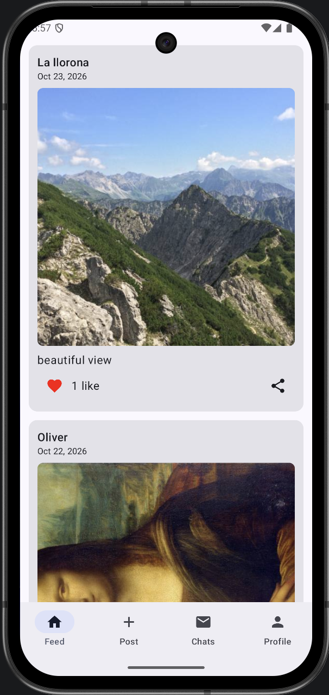
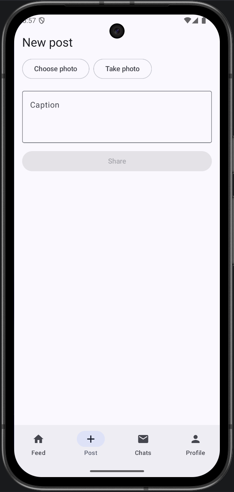
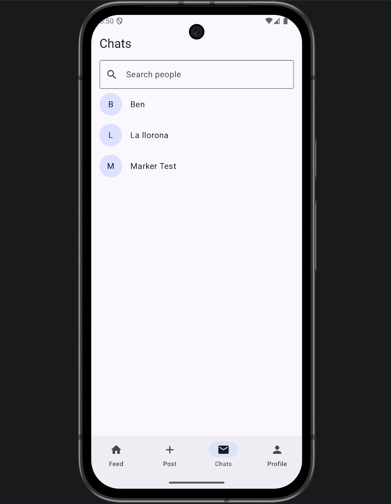
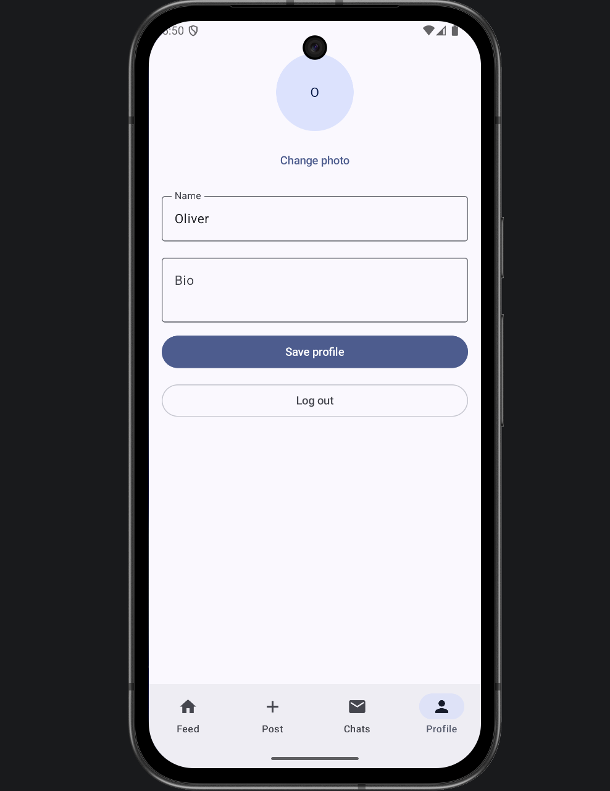

# Circle

An Android social media app where people can share photo posts, like each other's posts, and chat one-to-one in real time. Built with **Kotlin**, **Jetpack Compose** and **Firebase**.

<p align="center">
  
  
  
  
</p>

## Features

- **Accounts:** sign up and log in with email and password; login is remembered between launches
- **Photo feed:** posts with a photo and caption, newest first, with relative timestamps ("5 minutes ago")
- **Likes:** like and unlike posts, with the count updating live for everyone
- **New posts:** choose a photo from the gallery or take one with the camera
- **Share:** send a post's caption to any other app through the Android share sheet
- **Delete:** remove your own posts (with a confirmation dialog)
- **Profiles:** set your name, bio and profile picture
- **Chat:** real-time one-to-one messaging; messages appear instantly on both phones
- **Search:** find people by name in the Chats tab

## Tech stack

| Area | Technology |
|---|---|
| Language | Kotlin |
| UI | Jetpack Compose, Material 3 |
| State | AndroidX ViewModel with Compose state |
| Backend | Firebase Authentication, Cloud Firestore |
| Async | Kotlin coroutines (`kotlinx-coroutines-play-services`) |
| Build | Gradle (Kotlin DSL) with a version catalog |
| Min / target SDK | 24 / 37 |

## How it works

**Real-time updates.** Posts, users and messages are read through Firestore snapshot listeners, so the feed, like counts and chats update the moment anything changes, without refreshing.

**Releasing resources.** Each listener keeps a network connection open, so the app ties them to the Android lifecycle. A screen starts its listener when it becomes visible and removes it when the app is paused or the screen is closed (`LifecycleResumeEffect`). The ViewModel also removes any remaining listeners in `onCleared()`. Nothing keeps running while the app is in the background.

**Images without paid storage.** Firebase Storage needs a paid plan, so photos are stored directly inside Firestore documents as Base64-encoded JPEGs. Because a Firestore document is limited to 1 MB, each photo is decoded at a reduced size, scaled to at most 800 px (300 px for profile pictures), and compressed before upload. Decoding happens on a background thread so the UI stays smooth, and bitmaps are recycled straight after use.

**Conflict-free likes.** Likes are stored as a list of user IDs and updated with Firestore's `arrayUnion` / `arrayRemove`. The change happens on the server, so two people liking a post at the same moment never overwrite each other, and nobody can like a post twice.

**Chat IDs.** A conversation's ID is the two users' IDs sorted and joined (`uidA_uidB`). Whoever opens the chat first, both people always end up in the same conversation, with no duplicates.

### Firestore structure

```
users/{uid}                          name, bio, avatar
posts/{postId}                       authorId, authorName, caption, image, likes[], createdAt
chats/{uidA_uidB}/messages/{msgId}   senderId, text, sentAt
```

## Project structure

```
app/src/main/java/nz/ac/massey/circle/
├── MainActivity.kt      App entry point, screen switching and bottom navigation
├── Socialviewmodel.kt   App state; starts and stops Firestore listeners
├── Firebaserepo.kt      All Firebase Authentication and Firestore calls
├── ImageUtils.kt        Photo resizing, compression and Base64 conversion
├── Models.kt            Data classes (User, Post, Message) and screens
├── AuthScreen.kt        Login and sign-up
├── FeedScreens.kt       Feed, post cards, new post (picker, camera, share)
├── Chatscreens.kt       People list with search, chat screen
└── Profilescreen.kt     Profile editing and log out
```

## Running the project

The Firebase configuration file isn't included in this repository, so you need to connect the app to your own (free) Firebase project.

1. Clone the repository and open it in Android Studio.
2. In the [Firebase console](https://console.firebase.google.com), create a project and add an **Android app** with the package name `nz.ac.massey.circle`.
3. Download `google-services.json` and place it in the `app/` folder.
4. In **Authentication**, enable the **Email/Password** sign-in method.
5. Create a **Cloud Firestore** database and set its rules (see below).
6. Sync Gradle and run the app on an emulator or device.

### Firestore rules

These rules let signed-in users read everything but only change their own data:

```
rules_version = '2';
service cloud.firestore {
  match /databases/{database}/documents {
    match /users/{uid} {
      allow read: if request.auth != null;
      allow write: if request.auth.uid == uid;
    }
    match /posts/{postId} {
      allow read: if request.auth != null;
      allow create: if request.auth.uid == request.resource.data.authorId;
      allow delete: if request.auth.uid == resource.data.authorId;
      // Anyone signed in may update only the likes list
      allow update: if request.auth != null
        && request.resource.data.diff(resource.data).affectedKeys().hasOnly(['likes']);
    }
    match /chats/{chatId}/messages/{msgId} {
      allow read, create: if request.auth != null && chatId.split('_').hasAny([request.auth.uid]);
    }
  }
}
```

## Known limitations and ideas

- Anyone on the app can message anyone; a friends system with requests would be a natural next step.
- No push notifications for new messages yet (this would need Firebase Cloud Messaging).
- Photos taken with the camera are thumbnail quality, since the app uses the system camera's preview result.
- Base64 images work well at this scale; a larger app would move them to cloud storage.

## About

Built by **Shuairan (Oliver) Bi** as an individual project for 159.336 Mobile Application Development at Massey University, 2026.
